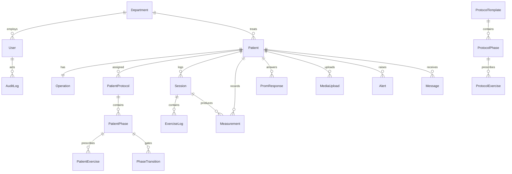

# PLAN

Glide: remote post-operative hand and upper limb physiotherapy.

## 1. Purpose and governing constraint

Post-operative patients carry out surgeon-prescribed rehabilitation at home, log their range
of motion and pain, and are monitored remotely, so they travel to hospital only when
clinically necessary.

The governing constraint, which overrides every other design consideration in this document:

> The application delivers, tracks and reports a prescription authored by a named surgeon or
> hand therapist. It never generates, infers or alters a prescription on its own.

Accuracy, safety and auditability rank above features, speed and cleverness.

## 2. Why Next.js rather than a React SPA

This application needs all of the following:

- Server-rendered pages behind authentication, so clinical data is never shipped to an
  unauthenticated client
- Protected API route handlers for the offline sync endpoint
- Server actions for clinical writes, so validation and audit logging cannot be bypassed
  from the client
- File and image upload handling for wound photographs and movement videos
- Scheduled background work for reminders
- An installable PWA target on low-end Android phones

A client-only React SPA would push every one of those into a separate backend service, which
means two deployables, two auth surfaces and a CORS boundary, for no benefit. Next.js App
Router covers all of them in one deployable.

## 3. Stack

| Concern | Choice | Note |
|---|---|---|
| Framework | Next.js 16 App Router, TypeScript strict | Scaffolded |
| Styling | Tailwind v4, shadcn/ui | Component substrate |
| Database | PostgreSQL, Prisma, schema-first | Migrations committed |
| Auth | Auth.js, credentials plus OTP | Roles PATIENT, THERAPIST, SURGEON, ADMIN |
| Validation | Zod at every input boundary | Shared client and server schemas |
| Forms | React Hook Form | |
| Charts | Recharts | ROM and pain trends |
| PWA | Serwist | `next-pwa` is unmaintained against App Router |
| Offline queue | IndexedDB via idb | Drains to `/api/sync` |
| Tests | Vitest, Playwright | Including an offline end-to-end run |
| Local infra | Docker Compose Postgres | One `npm run setup` |

Hosting is Vercel with managed Postgres. Two consequences are recorded here so they are not
lost later:

1. Identifiable patient data and wound photographs will sit with third-party cloud
   providers. This needs departmental and legal sign-off before any real patient use.
2. Vercel serverless functions cannot hold a long-lived scheduler, so reminders are Vercel
   Cron plus a queue table rather than an in-process background job.

Blob storage sits behind an adapter in `src/lib/storage/` so an on-premises swap later does
not touch feature code.

## 4. Data model



### Three decisions that shape everything downstream

**Measurements are one polymorphic table, not one table per instrument.** Each row carries
`instrumentKey`, `instrumentVersion`, a JSONB payload validated by that instrument's Zod
schema, plus `value`, `recordedAt`, `postOpDay`, `enteredByUserId`, `enteredByRole` and
`method`. Versioning the instrument means a later scoring correction never silently rewrites
historical results.

`method` is `SELF` or `CLINIC`. Charts render the two differently, because a patient reading
a paper goniometer one-handed and a therapist measuring in clinic are not equivalent
evidence, and presenting them identically would be misleading.

**A patient protocol is a deep copy of the template, not a foreign key to it.** Editing a
template must never retroactively change what a patient currently under treatment is being
told to do. Assignment copies phases and exercises into patient-owned rows.

**Every clinical write is append-only.** Nothing is hard-deleted. A correction is a new row
superseding an older one. `AuditLog` records actor, action, entity, before and after values,
IP address and user agent for every write.

`PhaseTransition` rows cannot exist without an `approvedByUserId`. The engine flags
eligibility for progression; only a clinician advances a phase.

## 5. Route map

```
/(auth)
  /login                        phone plus OTP, PIN fallback
  /verify-otp

/(patient)
  /today                        current phase exercises only
  /log/[sessionId]              reps, holds, ROM, pain, swelling, stiffness
  /progress                     own trends, streaks, milestones
  /help                         department contact, how to get here

/(clinic)
  /worklist                     risk-sorted: red flag, non-adherent, plateau, on track
  /enrol
  /patients/[id]
  /patients/[id]/timeline       ROM vs expected curve, pain, adherence heat map, media
  /patients/[id]/protocol       assign and edit, approve phase progression

/(admin)
  /users
  /templates, /templates/[id]   library, clinician sign-off
  /audit

/api
  /auth/[...nextauth]
  /sync                         offline queue drain, idempotent
  /cron/reminders
  /export/[kind]                pdf | docx | xlsx
```

## 6. Measurement module

`src/lib/clinical/instruments/`, one file per instrument. Each exports a typed, versioned
definition: Zod schema, plausible-range metadata, and a pure scoring function with no
database or React dependency, so it is trivially unit-testable.

- Finger ROM per digit: MCP, PIP, DIP active and passive, with TAM, TPM and extension lag
  derived
- Strickland and Buck-Gramcko-Lister grading from TAM for flexor tendon repairs
- Kapandji thumb opposition, 0 to 10
- Wrist: flexion, extension, radial and ulnar deviation, pronation, supination
- Elbow: flexion, extension, arc
- Shoulder: forward flexion, abduction, external and internal rotation
- Grip and pinch strength in kg, optional, never required
- Sensory: Semmes-Weinstein monofilament level, static two-point discrimination
- PROMs: QuickDASH and PRWHE, storing item-level responses alongside the computed score,
  scheduled at baseline, 6 weeks, 3 months, 6 months, 12 months
- Vancouver Scar Scale, therapist entry only

Passive range of motion is clinician-entered only. Patients log active range of motion. A
patient with one operated limb cannot reliably move that limb passively and read a
goniometer at the same time, so patient-entered passive values would be recorded evidence of
unknown quality.

Range validation warns and never blocks, both for anatomically implausible values and for
sudden large changes measured against that patient's own history.

## 7. Alert rules engine

One declarative file, `src/lib/clinical/rules.ts`, exporting rule objects with a key,
severity, evaluation window and a pure predicate over a patient context object. Pure
functions in, alerts out, testable without a database.

| Rule | Trigger | Severity |
|---|---|---|
| Suspected tendon rupture | Sudden loss of active flexion or extension at a previously active joint, with preserved passive motion | Urgent |
| Infection | Fever, spreading redness, discharge, or increasing pain after post-operative day 5 | Urgent |
| Suspected CRPS | Disproportionate pain plus swelling plus stiffness plus colour or temperature change across consecutive logs, screened against Budapest criteria | Review |
| Neurovascular compromise | Numbness, colour change, or new cold intolerance | Urgent |
| Plateau | No meaningful TAM gain across the configured window | Review |
| Non-adherence | Sessions missed beyond the configured threshold | Outreach |
| Splint non-compliance | Reported non-wear during a protective phase | Outreach |

Thresholds live in seeded configuration marked unapproved, editable per protocol, requiring
clinician sign-off before the rule is active. They are proposed starting values, not clinical
recommendations.

Urgent alerts surface on the clinician worklist immediately, fire a notification, and show
the patient a calm instruction to contact the department together with its phone number and
travel note. No urgent finding is ever presented to a patient as probably fine.

## 8. Hard safety constraints

These are enforced in code and covered by tests, not left to convention.

1. No exercise reaches a patient unless it belongs to their surgeon-approved, currently
   active phase. Enforced at the query layer and again in the server action.
2. No AI-generated clinical advice anywhere patient-facing. Any LLM use is limited to
   translating clinician-written messages, plain-language rephrasing of clinician-written
   text, and summarising logged data for the clinician.
3. A non-dismissible footer on every patient screen states that the app supplements and does
   not replace review by the treating surgeon.
4. Every clinical write is append-only and audit-logged.
5. A protocol template with `reviewedBy` null cannot be assigned to a patient. Enforced by a
   database constraint, not only by the UI.

## 9. Build order

Pausing for review after steps 1, 3 and 5.

- [x] 1. `PLAN.md`, `PROGRESS.md`, scaffold, git init
- [ ] 2. Prisma schema, migrations, 15 seeded protocol templates
- [ ] 3. Auth, roles, measurement module with full unit tests
- [ ] 4. Clinician side: enrolment, protocol assignment, worklist, patient timeline
- [ ] 5. Patient side: session screen, logging, offline sync, PWA install
- [ ] 6. Alert rules engine and notifications
- [ ] 7. Exports: PDF progress report, DOCX clinic letter, XLSX audit
- [ ] 8. Urdu localisation with RTL, accessibility pass, Playwright end-to-end
- [ ] 9. `README.md` with setup, deployment, backup and clinical governance

## 10. Acceptance criteria

- A patient completes a full week of sessions entirely offline on a mid-range Android phone,
  and everything syncs on reconnection with no data loss and no duplicate records
- Every scoring calculation has a unit test named for its literature worked example
- A clinician goes from login to identifying the highest-risk patient in under ten seconds
- No patient-facing screen displays clinical advice not authored or approved by a named
  clinician
- `npm run setup` produces a working seeded app on a clean machine

## 11. Open questions for the department

These change scoring or safety behaviour, so they are not being guessed at. Steps 1 and 2 do
not depend on the answers.

1. **Strickland variant.** The original 1980 classification puts excellent at 75 to 100
   percent; the modified version puts it at 85 to 100 percent. Both are implemented as
   versioned instruments. Which is the department default?
2. **Vancouver Scar Scale version.** The pigmentation subscale differs between published
   versions, giving a total of 0 to 13 or 0 to 14. Which is in use?
3. **TAM extension deficit convention.** Confirm deficits are subtracted from summed flexion,
   and that a hyperextending joint is recorded as zero deficit rather than a negative value.
4. **Plateau threshold.** Proposed default is under 10 degrees TAM gain across 14 days within
   an active phase. What is the surgeon's number?
5. **Non-adherence threshold.** Proposed default is under 50 percent of prescribed sessions
   across 7 rolling days. What is the surgeon's number?
6. **Infection rule day cut-off.** The brief specifies increasing pain after post-operative
   day 5. Do fever, spreading redness and discharge also start at day 5, or from day 0?
7. **CRPS persistence window.** How many consecutive logs before the Budapest screen fires?
8. **Urgent alert routing out of hours.** One department number, or an on-call rota? A rota
   requires an on-call schedule table in the schema.
9. **OTP delivery.** Which SMS gateway? What happens when two enrolled patients share a
   household phone?
10. **Media retention.** How long are wound photographs and videos kept, and who may view
    them?
11. **PROM licensing.** Confirm departmental permission to embed QuickDASH and PRWHE items.
12. **Post-operative day zero.** Confirm day 0 is the date of surgery, and which timezone
    fixes the date boundary for patients logging near midnight.
